<div align="center">

# 🐾 Kennel

**A workspace for AI CLI agents, terminals and files**

[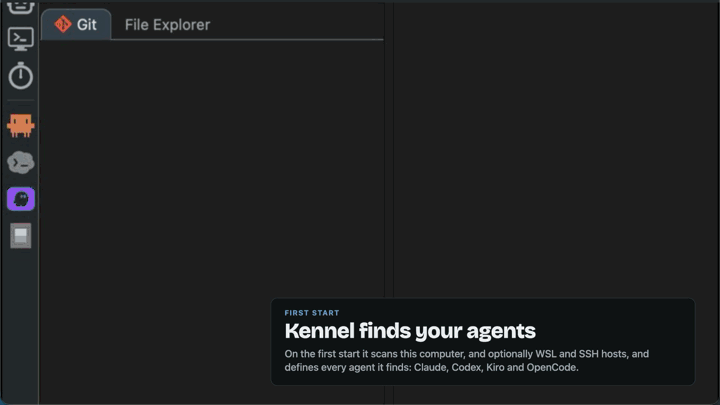](media/promo/kennel-promo.mp4)

**[▶ Watch the one-minute tour](media/promo/kennel-promo.mp4)** ·
**[Open the interactive tour](https://htmlpreview.github.io/?https://github.com/eranif/kennel/blob/main/media/promo/kennel-promo.html)**


</div>

Kennel is a fast, native desktop application for working with interactive AI CLI agents: **Claude
Code**, **OpenAI Codex**, **Kiro CLI**, **OpenCode** or any tool of your own. It runs many agent
sessions side by side in one window, and it gives you what you need around them: a file explorer,
a git view, an editor, a code reviewer that is a second agent, and a search for everything.

Sessions run on this machine, in **WSL** or on **remote hosts over SSH**, and the tools around
them always show the session you are working in. **When you restart the application or reboot the
machine, every session returns where it left off**, using the native resume flag of the agent
(for example Claude's `--continue` or Kiro's `--resume`).

---

## Contents

[Download](#download) · [Why Kennel?](#why-kennel) · [Screenshots](#screenshots) ·
[What's New in 2.0](#whats-new-in-20) · [Core Concepts](#core-concepts) ·
[Getting Started](#getting-started) · [The Side Bar](#the-side-bar) ·
[Archive a Session](#archive-a-session) · [Goto Anything](#goto-anything) ·
[The Terminal](#the-terminal) · [Review Buddy](#review-buddy) ·
[Files and Search](#files-and-search) · [Scheduled Jobs](#scheduled-jobs) ·
[Managing Agents](#managing-agents) · [Keyboard Shortcuts](#keyboard-shortcuts) ·
[Session Persistence](#session-persistence--restore) · [Customization](#customization) ·
[Installation](#installation) · [Where Kennel Stores Things](#where-kennel-stores-things) ·
[Troubleshooting](#troubleshooting)

---

## Download

Get the installer or the application bundle for your platform from the
**[Releases](https://github.com/eranif/kennel/releases)** page:

| Platform | Notes |
|---|---|
| **macOS (Apple Silicon)** | A signed and notarized application bundle (`.zip`). |
| **Windows 11** | An installer (`.exe`), built on GitHub Actions. |
| **Linux** | Build from source, see [BUILDING.md](BUILDING.md). |

---

## Why Kennel?

Anyone who uses AI coding agents from the terminal knows the problems: a dozen terminal tabs, no
way to tell which agent is waiting for you, and lost context whenever a window closes. Kennel
solves these problems and adds the tools that surround an agent.

- 🗂️ **One window for everything.** Agent sessions, plain terminals and files are the tabs of one
  notebook. The tabs of a session group sit together under the name of the group, and
  **Ctrl+Tab** switches between pages in most-recently-used order.
- 🚦 **See what each agent is doing.** A spinner, a check mark or an orange pulse on the tab tells
  you whether an agent is working, done or blocked and waiting for you. The **Activity** pane
  lists these sessions in one place.
- 🔄 **Never lose your place.** Sessions, terminals and open files return at the next start, and
  agents resume their conversation with their native resume flag. A session can also be
  **archived** and restored later.
- 📁 **Files and git next to the session.** The **Side Bar** has a file explorer and a git view
  that always show the active session, on this machine, in WSL or on a remote host.
- 🤖 **A second agent that reviews the first.** **Review Buddy** reviews the changes of a session
  and sends its findings back to the first agent, with no one in between.
- 🔎 **Find anything fast.** **Goto Anything** (`Ctrl`/`Cmd`+`Shift`+`P`) searches the menus, the
  open pages and the actions of the current page.
- ⚡ **A true, fast terminal.** Every session is a full PTY terminal, drawn with **OpenGL** on all
  platforms. It supports advanced ANSI sequences such as **OSC 9;4** (progress bars) and
  **OSC 7501** (Program Status Protocol), the clipboard, and mouse events for TUI applications,
  so any interactive CLI works as it does in your shell. See [The Terminal](#the-terminal).
- 🧩 **Any agent, no code needed.** The first start finds the agents that are installed. More
  agents are defined in a wizard or in JSON, locally or over SSH.
- 🌈 **Make it yours.** Terminal color themes (the default is **Mariana**), an application theme
  that can follow the terminal theme, your own fonts, and an icon for each agent.

---

## Screenshots

*Real screenshots of Kennel 2.0 with demo sessions.*

| One window for every agent | Working, done and blocked at a glance |
|---|---|
| 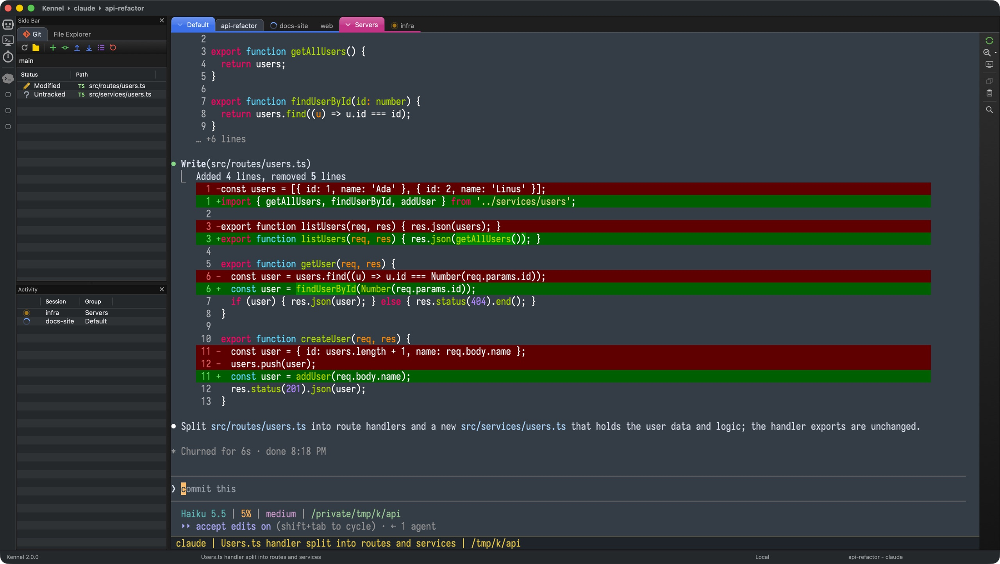 | 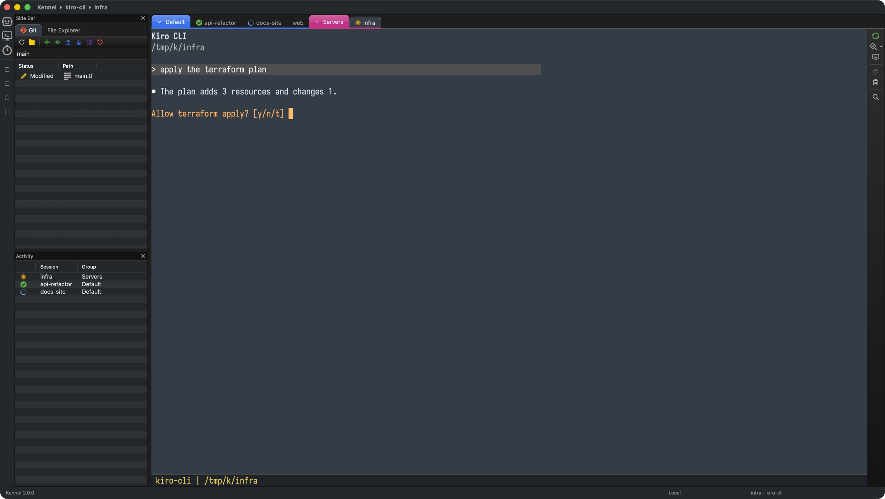 |

| Ctrl+Tab switches in most-recently-used order | Goto Anything |
|---|---|
| 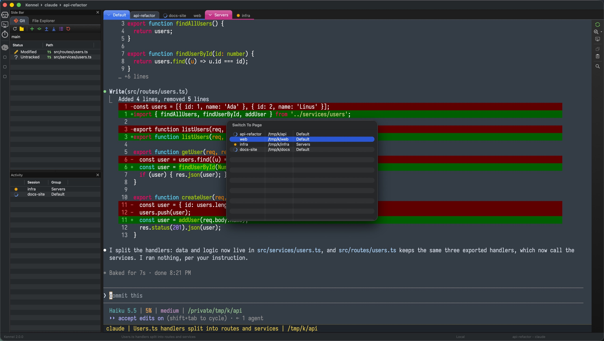 | 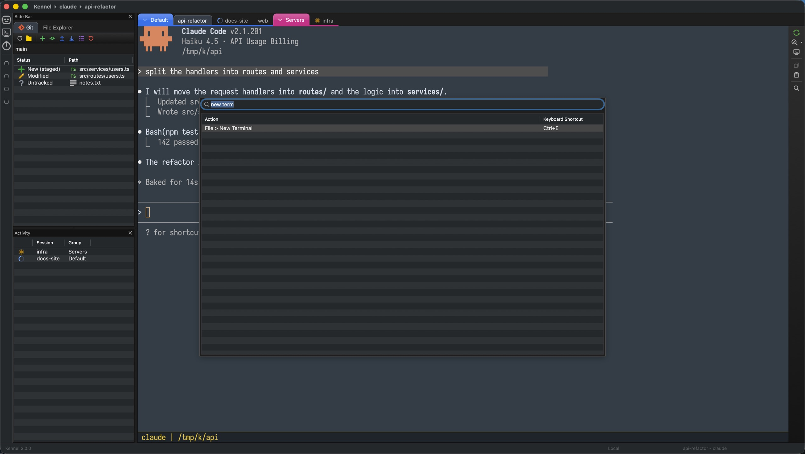 |

| The File Explorer follows the active session... | ...and shows the folder of another session |
|---|---|
| 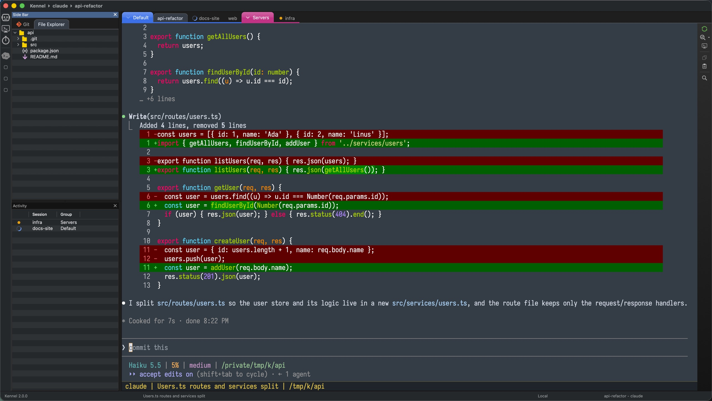 | 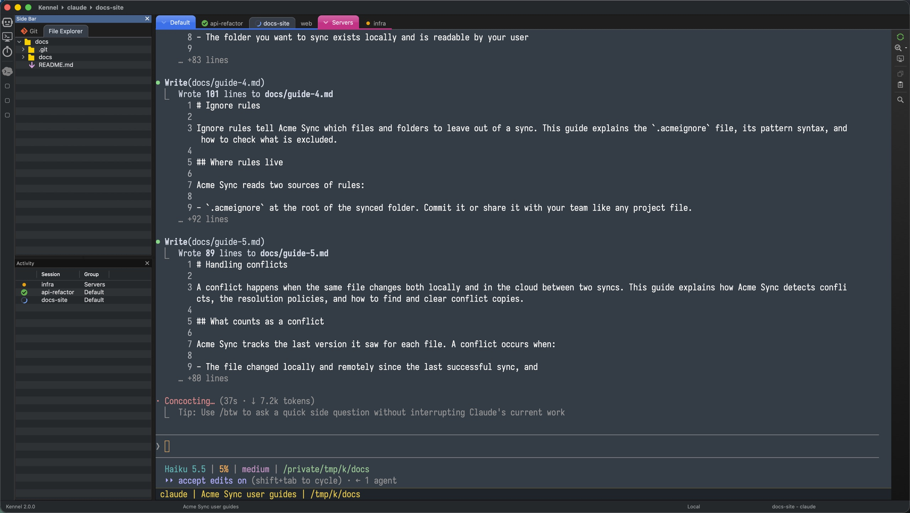 |

| Review Buddy: a second agent reviews the first | First start: Kennel finds your agents |
|---|---|
| 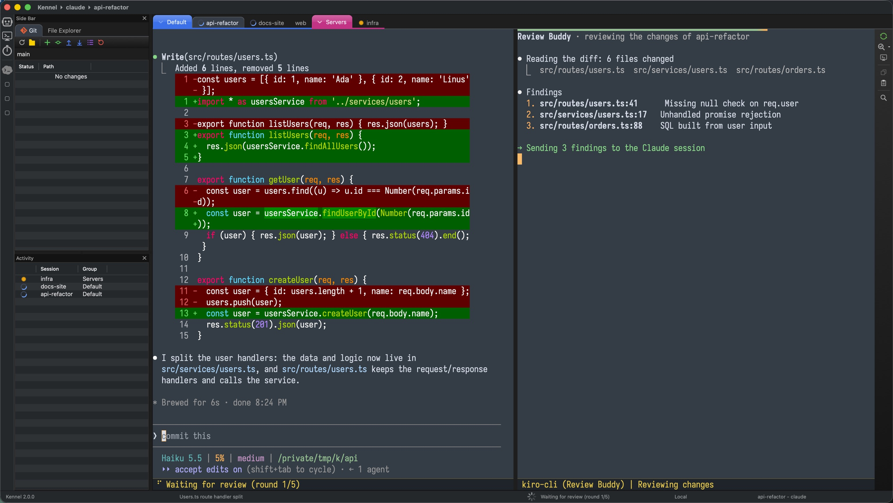 | 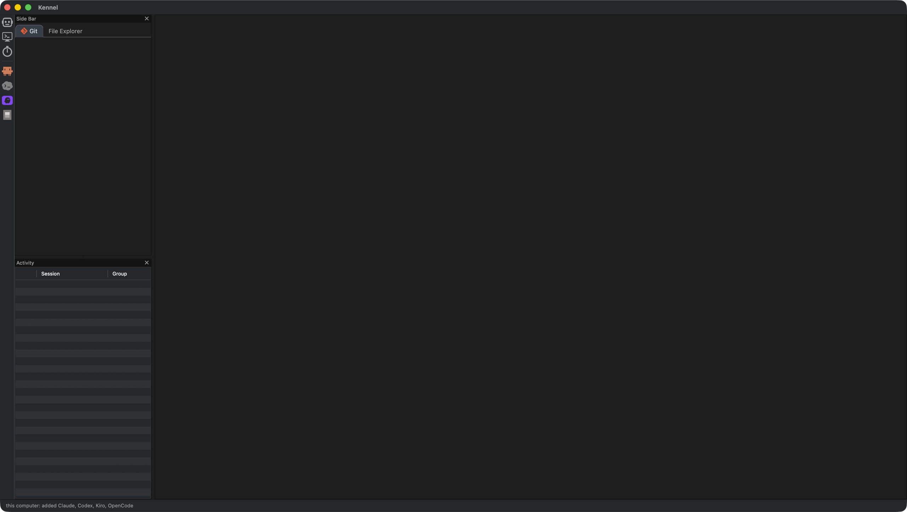 |

| Start an agent | Define a new agent |
|---|---|
| 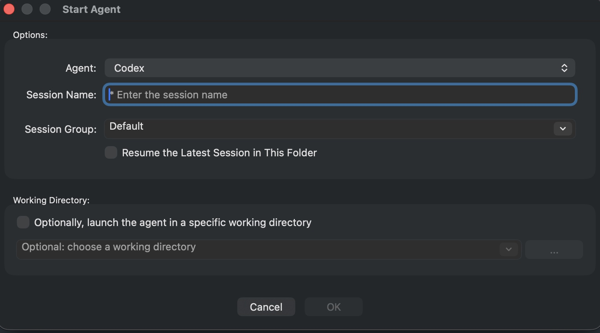 | 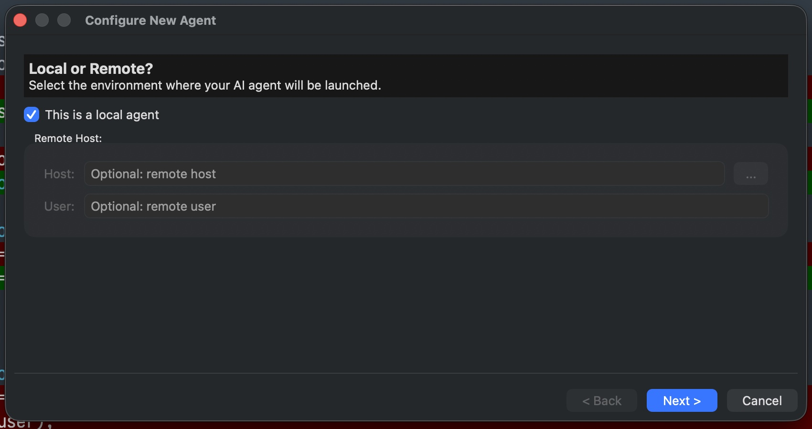 |

The screenshots and the tour are made with the scripts in [`media/`](media/AGENTS.md).

---

## What's New in 2.0

Version 2.0.0 is a redesign of the main window and of the terminal page:

- **One notebook** for all sessions, terminals and files, in place of the session tree. Tabs are
  grouped by session group, and the position of the tabs is yours to choose.
- **A Side Bar** with a **File Explorer** and a **Git** view (status, diff, add, commit, log,
  blame, push and pull) for local, WSL and remote locations.
- **An Activity pane** that lists the working, done and blocked sessions.
- **Archive** a session instead of closing it, and restore it from **File → Archived Sessions**.
- **Goto Anything** for menus, pages and page actions.
- **A toolbar, a header and a progress bar** for every terminal and file, on the left of the page,
  with the progress of Review Buddy shown in the header.
- **A search bar** for files and terminals, with replace for files.
- **Open files and terminals** return with the workspace, and file links in the terminal follow
  `cd` and open at the right line and column.
- **An application theme** that follows the terminal theme, or the system, dark or light setting.
- **Agent discovery** on the first start for **Claude Code**, **Codex**, **Kiro CLI** and
  **OpenCode**, including WSL distributions and SSH hosts.
- **Windows**: a newer ConPTY, color emoji, and an installer built on GitHub Actions.

See the [Release Notes](release-notes/RELEASE_NOTES_2_0.md) for the complete list of changes and
the upgrade notes. Earlier releases: [1.4.0](release-notes/RELEASE_NOTES_1_4.md),
[1.3.0](release-notes/RELEASE_NOTES_1.3.0.md).

---

## Core Concepts

| Concept | Description |
|---|---|
| **Agent** | A definition of *how to launch* an AI CLI: its executable, arguments, environment, icon and, optionally, a remote host or a WSL distribution. Kennel finds and defines **Claude Code**, **OpenAI Codex**, **Kiro CLI** and **OpenCode** when they are installed. |
| **Session** | A named, running instance of an agent in a working directory. Each session is a live terminal. |
| **Group** | A set of related sessions. The tabs of a group are shown together under a header with the name of the group. The **Default** group always exists. |
| **Terminal** | A plain terminal without an agent. Kennel restores it with its folder and shell. |
| **File** | A file open in the built-in editor, local or remote. |

The main area is a notebook with one tab for each session, terminal and file. The **Side Bar**
shows the files and the git status of the active page, and the **Activity** pane lists the
sessions that are working, done or blocked.

---

## Getting Started

### 1. First start

The first time Kennel starts, it looks for `claude`, `codex`, `kiro-cli` and `opencode` on this
machine, in the background, and defines an agent for each tool it finds. The status bar shows
what it found, and each new agent gets a button in the toolbar. Kennel then asks once whether to
search your **WSL distributions** (Windows only) and the **hosts of your SSH config** as well.
Agents can also be defined by hand at any time (see [Managing Agents](#managing-agents)).

### 2. Start an agent

Press **`Ctrl`/`Cmd`+`T`**, choose **File → Start Agent...**, or click the agent button in the
toolbar on the left. The **Start Agent** dialog provides:

- **Agent**: which CLI to launch.
- **Session Name**: a unique, descriptive label for the session.
- **Session Group**: an existing group, or a new name to create a group.
- **Working Directory**: where the agent runs. You can browse this machine, a WSL distribution
  or a **remote host over SSH**. Kennel remembers the last 10 folders.
  - *Resume the Latest Session in This Folder* relaunches the most recent agent run from that
    folder instead of starting a new one.

### 3. Work with your session

Click a tab to bring its terminal to the front. On the left of every session there is a vertical
**toolbar**:

| Tool | Description |
|---|---|
| **Restart** | Restarts the session. |
| **Review Buddy** | Starts a second agent that reviews the work of the session, and controls the review. |
| **Terminal** | Opens a terminal named `<Session> \| Terminal` on the same host and in the same folder as the session (agent sessions only). |
| **Copy**, **Paste** | Clipboard actions for the terminal that has the focus. |
| **Find** | Opens the search bar of the terminal. |

A **header** below the terminal shows `Agent Name | Title | Working Directory`, and a thin
**progress bar** shows the progress that a program reports. The tab of an agent shows what it is
doing:

| Icon | Meaning |
|---|---|
| A turning ring | The agent is **working**. |
| A green check mark | The agent is **done**. The mark goes away when you look at the page. |
| An orange pulse | The agent is **blocked** and needs you. |

The same icons are in the **Activity** pane, which lists the blocked sessions first. Kennel also
asks for your attention when a background session finishes while the window is inactive.

### 4. Organize your sessions

Right-click a tab for its context menu:

- **Rename...** renames the session (or **Rename Terminal** for a plain terminal).
- **Duplicate...** opens **Start Agent** with the agent, the group and a unique name filled in.
- **Move To Group** sends the session to another group, or creates a group with **New Group...**.
  A group that loses its last session is removed, except for **Default**.
- **Archive** stores the session so that you can restore it later (see
  [Archive a Session](#archive-a-session)).
- **Close** closes the session.

The **Group** submenu works on the whole group: **Start Agent...** in the group,
**Rename Group...**, **Close Group** and **Refresh Group** (restarts every session of the group).

Right-click the empty part of the tab bar to change the **Tab Position** (top, bottom, left or
right), or to turn **Group Tabs by Session Group** on or off.

---

## The Side Bar

The Side Bar has two tabs. Both show the location of the page you are working in: a folder on
this machine, in a WSL distribution or on a remote host, and they **change when you change
page**. A **terminal** has its own views, which follow the folder its shell is in.

### File Explorer

- Double-click a file to open it in the editor. Typing selects the next matching entry.
- The context menu provides **Refresh**, **New Folder...**, **New File...**, **Delete...**,
  **Show in Finder / Explorer / File Manager**, **Open with Default App**, **Copy Path** and
  **Set This Folder as Root**.
- A remote tree connects in the background, so a slow host never blocks the window.

### Git

The Git tab shows the branch and the changed files of the repository, with a status and a file
type icon for each file. A double-click opens the **diff** in a read-only page.

| Action | Description |
|---|---|
| **Add** | Stages the selected files. |
| **Reset** / **Reset Repo** | Restores the selected files, or the whole repository, after confirmation. |
| **Commit** | Opens a message dialog with **Amend** and **Signoff** options. |
| **Log** / **Blame** | Shows the log of the repository, or the blame of the selected file, in an editor. |
| **Push** / **Pull** | Runs in a terminal named `Git (<place>)`, so git can ask for credentials. |
| **Folder** | Shows the git status of another folder. |

By default, the Side Bar shows the working folder of the session. To use another folder,
right-click it in the explorer and choose **Set This Folder as Root**, or click **Folder** in the
git toolbar and browse to it (a parent folder is allowed). Only the active session changes, and
Kennel saves the choice with the session.

---

## Archive a Session

Archiving removes a session from the notebook and keeps it in `workspace.json`, so that you can
restore it later. Terminals cannot be archived.

- Use **Archive** in the context menu of a tab. If the agent is working, Kennel asks first.
- When you close an agent session, Kennel asks whether to **Archive**, **Close** or **Cancel**.
  Select **Do not ask again** to remember the answer, and change it later under
  **View → Close Button of a Session**.
- **File → Archived Sessions...** lists the archived sessions, with a filter box. Sort by any
  column, **Restore** a session with its resume option (the dialog stays open, so you can restore
  several sessions), or **Delete** an entry for good.

---

## Goto Anything

Press **`Ctrl`/`Cmd`+`Shift`+`P`** (it also works inside a terminal), or choose
**Search → Goto Anything...**. Type words to filter the list, move with the arrow keys or Page
Up / Page Down, press Enter to select and Escape to close. The list contains:

- the actions of the current page, such as **Restart Session**, **Start Review Buddy with ...**
  and **Close Review Buddy**;
- the open sessions, terminals and files;
- every enabled item of the menu bar, with its keyboard shortcut.

---

## The Terminal

The terminal is the core of Kennel. It is a true terminal emulator, not a text box that imitates
one, and it is built for speed and compatibility.

- **Fast rendering on all platforms.** The terminal is drawn with OpenGL on macOS, Windows and
  Linux, so the output of busy agents and full-screen TUI applications stays responsive. On
  Windows, emoji are drawn in color (with Direct2D), and wide characters (CJK and emoji) are not
  clipped.
- **Advanced ANSI escape sequences.** Kennel implements the sequences that modern CLI tools rely
  on, including:
  - **OSC 9;4** (taskbar progress bars): a thin progress bar above the terminal shows the
    progress that a program reports, as a percentage or as an animation.
  - **OSC 7501** (Program Status Protocol): a program tells Kennel that it is working, done or
    blocked. Kennel shows the status on the tab and in the **Activity** pane.
  - **OSC 7** and **OSC 9;9**: the shell reports its current folder. The header shows it, and
    relative paths that you click in the output are resolved against it.
  - Color queries such as **OSC 11**, so that applications can detect a light or a dark
    background (on Windows, with the newer ConPTY that Kennel ships).
- **Clipboard integration.** **Copy** copies the selected text. When nothing is selected, it
  copies the text that the program in the terminal put on the clipboard itself (for example tmux,
  or a TUI such as Claude Code), in full. **Paste** pastes into the terminal that has the focus.
- **Mouse events for TUI applications.** Mouse tracking goes to the program, so tmux, `mc`, `htop`
  and other TUI applications work with the mouse.
- **File links.** Ctrl+Click a path in the output. Paths such as `src/main.cpp:100:50` open the
  file in the editor at the given line and column, locally, in WSL and over SSH.
- **Everywhere.** The same terminal runs your local shell, a WSL distribution and an SSH session.

---

## Review Buddy

Review Buddy is an **autonomous code reviewer**. It starts a second agent on the same host as the
session, and the two agents work together until the review is done. **No user intervention is
needed**: you do not copy findings, switch between windows or start another round.

1. Start Review Buddy from the **Review Buddy** drop-down of the session toolbar (or from Goto
   Anything), and choose the agent that acts as the reviewer.
2. The reviewer reviews the unpushed work of the session in its own pane, next to the session,
   and writes its comments to a file in the working directory (`.agents/reviews/<id>/`).
3. Kennel tells the first agent to read the comments and fix them. The first agent confirms when
   it is done.
4. The reviewer reviews again, and the loop repeats until the reviewer reports that the work is
   clean, the review stalls or fails, or the round limit (5 by default) is reached.

The status line shows the progress at every step (for example `Waiting for review (round 1/5)`),
and the header shows it too. When the review ends, a marker shows the result: 👍 the review is
clean, 👎 it stalled or failed, and 🔴 the round limit was reached with open findings.

You stay in control. At any time you can send the request again, stop the review, open the latest
review, or close Review Buddy. A review needs a working directory that is a git repository.

---

## Files and Search

Kennel contains a built-in editor with syntax highlighting and line numbers.

- **Open files.** Ctrl+Click a path in a terminal to open the file. Relative paths follow `cd`
  (local, WSL and SSH), and `file:line:column` references open at the right position, for local
  and remote files. Remote files are downloaded over SFTP and uploaded again when you save. Use
  **File → New File** (`Ctrl`/`Cmd`+`N`) or **File → Open File...** (`Ctrl`/`Cmd`+`Shift`+`O`) to
  open files directly.
- **Edit menu.** While a file is in view, an **Edit** menu is added to the menu bar. A terminal
  keeps its own key bindings.
- **Search bar.** `Ctrl`/`Cmd`+`F` opens a search bar below the editor or the terminal, with
  incremental search, **Full word**, **Case sensitive** and, for files, **Replace** and
  **Replace all**. `F3` and `Shift`+`F3` find the next and the previous match.
- **Go to Line.** `Ctrl`/`Cmd`+`G` jumps to a line (`:12` or `:12:5`).
- **Unsaved changes.** When Kennel closes, every file with unsaved changes asks to save, discard
  or cancel. Open files return at the next start.

---

## Scheduled Jobs

Beyond interactive sessions, Kennel can run jobs on a timer, whether or not you are watching:

- A **job** runs either a raw shell command, or sends a one-shot prompt to a configured agent
  that runs in non-interactive mode.
- Each job uses one of two schedules, chosen with the **Schedule mode** dropdown:
  - **Every N Hours**: a fixed interval from 1 to 720 hours.
  - **Daily At**: once a day at a time of the day, set with the time picker on a 24-hour clock
    (for example, every day at 10:00).
- The scheduler checks once a minute, so a job starts within a minute of its target time. A daily
  job is always anchored to the exact `HH:MM` you picked, so a late start never moves the time
  forward from one day to the next.
- Editing the schedule of a job takes effect at once: the next run is computed again when you
  save.
- **Jobs → Manage Jobs...** opens a dialog with **New...**, **Edit...**, **Delete** and
  **Run Now**. The list shows the schedule of each job as `every Nh` or `daily at HH:MM`. A job
  can be enabled or disabled on its own. A disabled job is skipped, but its next-run time keeps
  moving, so no backlog of missed runs fires when you enable it again.
- Schedules are tracked while Kennel is running. If the application is closed (or the machine is
  asleep) at the time of a daily job, that day's run is skipped and not caught up later.
- Jobs start in a dedicated **Jobs** session group. These are one-shot runs, and they are not
  saved in the workspace like regular sessions.
- **Run Now** saves pending edits and focuses the terminal of the new session. Jobs that the
  scheduler starts run quietly in the background and do not take the focus.
- **Jobs → View Job Log...** shows every job run (start, end and failure) that is recorded in
  `~/.kennel/logs/jobs.log`, newest first, with a live filter box. Double-click (or press Enter
  on) a row to see the full record as formatted JSON in a read-only viewer.

---

## Managing Agents

Besides the agents that Kennel finds, you can define your own: a locally installed CLI, an
internal tool, or an agent that runs in WSL or on a **remote machine over SSH**.

Choose **File → Configure New Agent...** to open the **New Agent Wizard**, which has three steps.
**Settings → Manage Agents...** edits or removes the agents that are already defined.


### Step 1: Local or Remote?

Choose whether the agent runs on this machine or on a remote host over SSH. For a remote agent,
enter the host address and, optionally, a user name. The **...** button lists your saved SSH
hosts.

### Step 2: What to launch

Configure the identity and the command of the agent:

| Field | Purpose |
|---|---|
| **Name** | Display name shown in menus and tabs. |
| **Executable** | The command to run. The wizard finds the known CLIs (`claude`, `codex`, `kiro-cli`, `opencode`) on this machine or on the remote host. |
| **Launch Args** | Arguments passed on every launch (for example `--agent my-agent`). |
| **Resume Args** | Flags used to resume a previous session (for example `--resume` or `--continue`). Suggestions are available with **...**. |
| **Image** | An SVG icon for the agent. You can browse the shipped icons with **...**. |

### Step 3: Shell & Environment

| Field | Purpose |
|---|---|
| **Login Shell** | Overrides the shell that starts the agent (for example `/bin/zsh` or `wsl.exe`). |
| **Environment Variables** | Extra name/value pairs for the agent process. Use the **New** and **Delete** buttons. |

Click **Finish**, and the new agent is available at once in the toolbar and in the **Start Agent**
dialog.

---

## Keyboard Shortcuts

`Ctrl` is `Cmd` on macOS, except where noted.

| Action | Shortcut |
|---|---|
| Start Agent | `Ctrl` + `T` |
| New Terminal | `Ctrl` + `E` |
| New File | `Ctrl` + `N` |
| Open File | `Ctrl` + `Shift` + `O` |
| Goto Anything | `Ctrl` + `Shift` + `P` |
| Toggle All Views | `Ctrl` + `M` (the physical `Ctrl` key, also on macOS) |
| Switch to the Next Page | `Ctrl` + `Tab` (the physical `Ctrl` key, also on macOS) |
| Switch to the Previous Page | `Ctrl` + `Shift` + `Tab` (the physical `Ctrl` key, also on macOS) |
| Restart the Current Session | `F5` |
| Rename Session | `F2` |
| Find | `Ctrl` + `F` |
| Find Next / Previous | `F3` / `Shift` + `F3` |
| Go to Line | `Ctrl` + `G` |
| Save the Open File | `Ctrl` + `S` |
| Close the Editor | `Ctrl` + `W` |

The page switcher lists every open session, terminal and file, most recently used first. Keep
`Ctrl` pressed and press `Tab` or `Shift`+`Tab` to move through the list, then release `Ctrl` to
switch (`Esc` cancels).

---

## Session Persistence & Restore

Kennel remembers your work between runs. At the next start, it restores each session and, where
the agent supports it, resumes the conversation with the native resume flag of the agent
(configured as **Resume Args**):

| Agent | Resume |
|---|---|
| Claude Code | `claude --continue` |
| OpenAI Codex | `codex resume --last` |
| Kiro CLI | `kiro-cli chat --resume` |
| OpenCode | `opencode --continue` |

Plain terminals return with their last folder and shell, and open files return as well (unsaved
edits are not kept). Closing Kennel, or rebooting the machine, does not cost your agent its
context.

Sessions that exit on their own (with `Ctrl-D` or `exit`) are removed automatically.

---

## Customization

- **Terminal themes.** Pick from a large collection of color themes in **Settings → Theme**, with
  a live preview. Changes apply at once, without a restart. The default is `Mariana`.
- **Application theme.** Choose **Follow terminal theme**, **System**, **Dark** or **Light** in
  **Settings**. Toolbars, icons and lists follow the theme.
- **Font.** Set the terminal font and size in **Settings → Change Terminal Font...**, with a live
  preview.
- **Tabs.** Set the position of the tabs and of the Side Bar tabs, the color of the tab outline,
  and a close button on every tab. A middle click always closes a tab. Right-click the tab bar
  for **Tab Position** and **Group Tabs by Session Group**.
- **Terminal preferences.** Set the size of the scrollback buffer.
- **Layout.** Show or hide the **Side Bar** and the **Activity** pane from the **View** menu.
  **Toggle All Views** (`Ctrl`+`M`) hides every pane except the pages. **View → Reset Kennel
  Layout** restores the default layout.
- **Remote hosts.** Manage reusable SSH hosts in **Settings → Manage Remote Hosts...**.
- **Update checks.** Use **Settings → Check for Updates...** to look for a newer version.
- **Plain terminals.** Open a terminal without an agent with **File → New Terminal**
  (`Ctrl`+`E`).

All settings are stored under `~/.kennel/` and can be edited in the application.

---

## Installation

For build prerequisites, instructions for each platform and the developer guide, see
**[BUILDING.md](BUILDING.md)**.

---

## Where Kennel Stores Things

Everything is stored under `~/.kennel/`:

```
~/.kennel/
├── config.json      # Your agent definitions and job definitions
├── workspace.json   # Your sessions, open files and archived sessions
├── .persist.json    # UI preferences (window size, theme, fonts) - safe to delete
└── logs/
    ├── kennel.log   # Application log
    └── jobs.log     # Job run history (JSON Lines: one JSON object per line)
```

A corrupt `config.json` or `workspace.json` recovers by itself. Kennel saves the damaged file as
`*.bak-<timestamp>` and falls back to safe defaults, so the application always starts.

Pass `-d <dir>` on the command line to store all of the above under `<dir>/.kennel` instead of
`~/.kennel`. This is useful for running several Kennel instances side by side with independent
data.

### Advanced: editing agents as JSON

Agents are stored in `config.json`, in the `agents` array. The **Manage Agents** dialog and the
wizard are the friendly front end, but you can edit the file directly:

```json
{
  "version": 1,
  "global": {},
  "agents": [
    {
      "name": "Claude Code",
      "executable": "claude",
      "baseArgs": [],
      "resumeArg": "--continue",
      "iconPath": "claude-code.svg",
      "extraArgs": [],
      "env": {}
    },
    {
      "name": "Kiro CLI",
      "executable": "kiro-cli",
      "baseArgs": ["chat"],
      "resumeArg": "--resume",
      "iconPath": "kiro.svg",
      "extraArgs": [],
      "env": {}
    },
    {
      "name": "Remote Builder",
      "executable": "kiro-cli",
      "baseArgs": ["chat"],
      "resumeArg": "--resume",
      "iconPath": "builder.svg",
      "extraArgs": [],
      "remoteHost": "dev-box.example.com",
      "remoteUser": "user",
      "env": {
        "PATH": "/home/user/python3/bin:$PATH"
      }
    }
  ]
}
```

Set `remoteHost` and `remoteUser` to run an agent over SSH.

---

## Troubleshooting

**A session does not start.** Make sure that the **Executable** of the agent is on your `PATH`
(or use an absolute path). The exact command and the error are in `~/.kennel/logs/kennel.log`.

**A remote (SSH) agent cannot connect.** Confirm that you can run `ssh <user>@<host>`
non-interactively (with key-based authentication). Kennel uploads a small helper and runs the
agent over an interactive SSH session.

**Sessions do not return after a restart.** Verify that `~/.kennel/workspace.json` exists and is
readable. If it was corrupt, look for a `workspace.json.bak-<timestamp>` backup.

**The panes are missing or in the wrong place.** Use **View → Reset Kennel Layout**.

**Theme colors look wrong.** Select a built-in theme in **Settings → Theme** and check the log
for theme-loading errors.

---

## License

Kennel is licensed under the **BSD 3-Clause License**. See [`LICENSE`](LICENSE).

## Author

**Eran Ifrah**: [GitHub](https://github.com/eranif)

## Related Projects

- [CodeLite IDE](https://codelite.org): the cross-platform, open-source IDE.
- [wxTerminalEmulator](https://github.com/eranif/wxTerminalEmulator): the embedded terminal
  control that powers the sessions of Kennel (fetched automatically at build time).
- [wxWidgets](https://www.wxwidgets.org): the cross-platform GUI toolkit that Kennel is built on.
